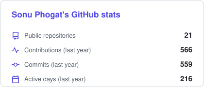
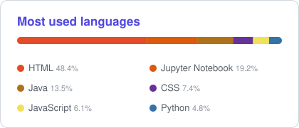
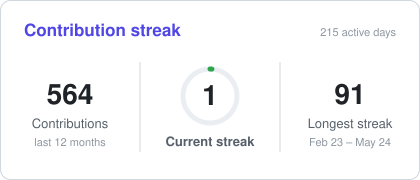
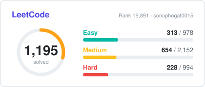
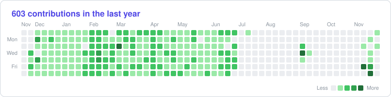

  

<h1 align="center">Hi, I'm Sonu Phogat 👋</h1>
<h3 align="center">Data Science & AI student · Ex-MIS Executive (3+ yrs) · Python · SQL · Power BI · Excel · Java</h3>

  
  
  
  

---

### 🙋 About me

- 🎓 Studying **Data Science & AI** at **Gisma University of Applied Sciences**, Berlin
- 💼 **MIS Executive** at **SGL Marketing Co** (Mar 2025 – Feb 2026): daily & weekly MIS reports in **Excel**, **Power BI** dashboards used by management, automated manual reports, data checks for error-free reporting
- 💼 **MIS Associate** at **TPF Getinsa Euroestudios** (Jul 2022 – Aug 2024): daily & weekly MIS reports in **Excel**, **Power BI** dashboards used by managers, automated recurring reports, data cleaning and validation
- 🧑‍💻 **Java & Full-Stack Development** training at **AccioJob** (2022 – 2024): Java, DSA, SQL, HTML/CSS/JavaScript, React
- 📊 I turn raw business data into decisions, from reports and dashboards to end-to-end ML pipelines
- 💻 Background in **Java** and **web development** (HTML, CSS, JavaScript, React)
- 🧠 **1,185+ LeetCode problems solved** (309 easy · 652 medium · 224 hard)
- 🔍 **Open to:** Werkstudent, internship and entry-level roles in **data analysis, BI and data science**
- 📍 Based in Berlin, Germany 🇩🇪 · originally from Haryana, India 🇮🇳

---

### ⭐ Featured projects

| Project | What it does | Tech |
|---|---|---|
| ⚖️ [**EU AI Act Navigator (RAG)**](https://github.com/sonu2002/eu-ai-act-rag) · [live demo](https://sonu2002.github.io/eu-ai-act-rag/) | Ask the EU AI Act a question in plain English and get the exact articles with citations. Compares keyword, semantic, hybrid and re-ranked retrieval on 50 verified questions (**Hit@5 94%**); optional LLM answer that must cite its sources. | Python, embeddings, BM25, cross-encoder, LLM APIs / Ollama |
| ⚡ [**Germany Electricity Demand Forecast**](https://github.com/sonu2002/germany-energy-forecast) · [live dashboard](https://sonu2002.github.io/germany-energy-forecast/) | Day-ahead forecast of Germany's hourly power demand from official SMARD data: **MAPE 2.78%**, 42% better than the naive baseline, 80% uncertainty bands. Re-trains and publishes itself every morning. | Python, scikit-learn, time series, GitHub Actions |
| 📉 [**Customer Churn Prediction + Explainable AI**](https://github.com/sonu2002/customer-churn-xai) · [live demo](https://sonu2002.github.io/customer-churn-xai/) | Predicts which customers will cancel (**ROC AUC 0.842**), explains every prediction, and chooses who gets a retention offer: **€40k** expected profit instead of −€656 when calling everyone. What-if simulator in the browser. | Python, scikit-learn, explainable AI, JavaScript |
| 🚦 [**Berlin Road Safety Analysis**](https://github.com/sonu2002/berlin-road-safety) · [live map](https://sonu2002.github.io/berlin-road-safety/) | All **86,894** injury accidents in Berlin 2019–2025 on an interactive map: hotspots, trends (serious accidents **−18%**), districts and what makes an accident serious (adjusted odds ratios). Refreshes itself monthly. | Python, pandas, geospatial, statistics, Canvas |
| 📊 [**Sales BI Dashboard (SQL + DuckDB)**](https://github.com/sonu2002/sales-bi-dashboard) · [live dashboard](https://sonu2002.github.io/sales-bi-dashboard/) | **1 million** invoice lines modelled into a tested star schema with SQL (DuckDB): KPIs, cohort retention, RFM segments and a data-quality report, filterable by market. Every chart shows its SQL. | SQL, DuckDB, Python, data modelling, BI |
| 🏠 [**Berlin Airbnb Analysis & Price Predictor**](https://github.com/sonu2002/berlin-airbnb-analysis) · [live demo](https://sonu2002.github.io/berlin-airbnb-analysis/) | Analysis of **8,127** Berlin listings with pandas and SQL, plus a gradient-boosting price model (median error **€27**) that runs live in the browser. | Python, pandas, scikit-learn, SQL, JavaScript |
| 💶 [**Expense Tracker REST API**](https://github.com/sonu2002/expense-tracker-api) | Spring Boot API with CRUD, filtering, validation, monthly summaries, Swagger docs, **10 automated tests** and Docker + PostgreSQL. | Java 17, Spring Boot, JPA, PostgreSQL, Docker |
| 🏦 [**Corporate Insolvency Prediction**](https://github.com/sonu2002/M505-AI-ML-GH1057991) | End-to-end ML pipeline predicting company bankruptcy from 64 financial ratios. Tuned gradient boosting reaches **ROC AUC 0.979** and **95% precision** on held-out data. | Python, scikit-learn, imbalanced-learn, pandas |
| 🛒 [**Online Retail Data Analysis**](https://github.com/sonu2002/M504-AI-Applications-GH1057991) | Exploratory analysis of **541,909** e-commerce transactions answering 8 business questions: top products, customer concentration, returns and basket analysis. | Python, pandas, NumPy, Matplotlib |
| 🔎 [**Search Engine**](https://github.com/sonu2002/java-search-engine) | A working search engine: a web crawler that indexes pages into MySQL and a servlet web app that ranks results and stores search history. | Java, JSP/Servlets, MySQL, Jsoup, Tomcat |
| 📈 [**Crypto Market Tracker**](https://github.com/sonu2002/crypto-market-tracker) · [live demo](https://sonu2002.github.io/crypto-market-tracker/) | React dashboard showing live top-10 cryptocurrency prices from the CoinGecko API, with search and sorting by market cap and 24h change. | React, Vite, REST API |
| 🧩 [**LeetCode Solutions**](https://github.com/sonu2002/Leetcode-submissions) | Java solutions to data structures & algorithms problems, auto-synced from [LeetCode](https://leetcode.com/u/sonuphogat0015/). | Java, DSA |

➡️ More: <a href="https://github.com/sonu2002/spotify-web-clone">Spotify web clone</a> · <a href="https://github.com/sonu2002/kanban-todo-app">Kanban to-do app</a> · <a href="https://github.com/sonu2002/react-movie-genre-filter">React movie filter</a> · <a href="https://github.com/sonu2002/java-snake-game">Java Snake game</a> · <a href="https://github.com/sonu2002/java-swing-text-editor">Java text editor</a> · <a href="https://github.com/sonu2002?tab=repositories">all repositories</a>

---

### 🛠️ Skills

**Data, ML & BI** 

**Databases & Backend** 

**Frontend** 

**Tools** 

---

### 📊 GitHub & LeetCode stats

  
  

  
  

  

  <picture>
    <source media="(prefers-color-scheme: dark)" srcset="https://raw.githubusercontent.com/sonu2002/sonu2002/output/github-snake-dark.svg"/>
    <source media="(prefers-color-scheme: light)" srcset="https://raw.githubusercontent.com/sonu2002/sonu2002/output/github-snake.svg"/>
    
  </picture>

All cards are generated by my own GitHub Action and refresh every day.

---

<i>Always learning, always building. Feel free to reach out! 🚀</i>

